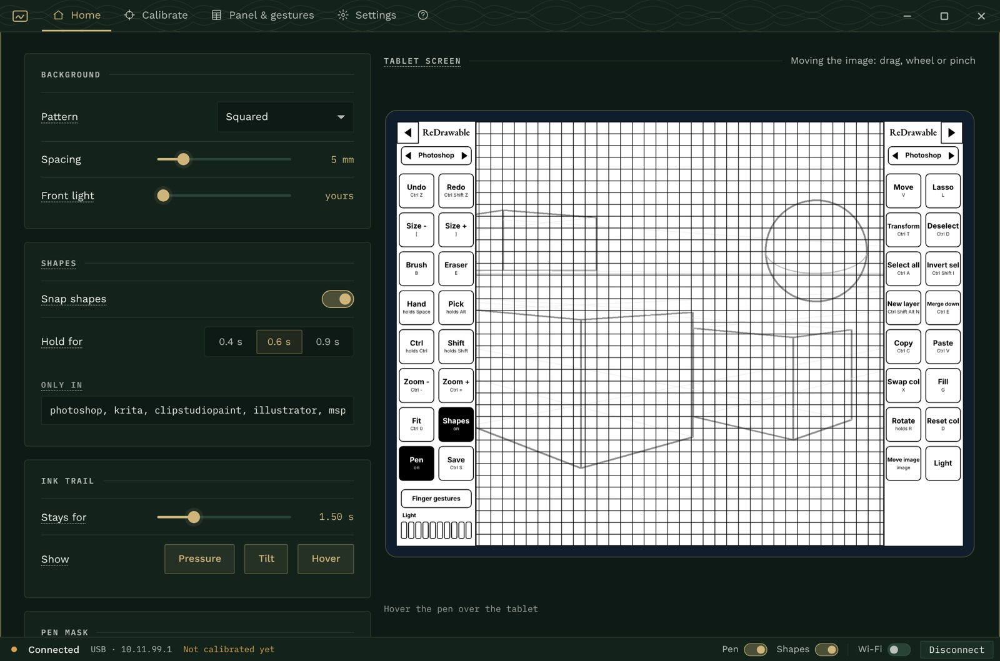
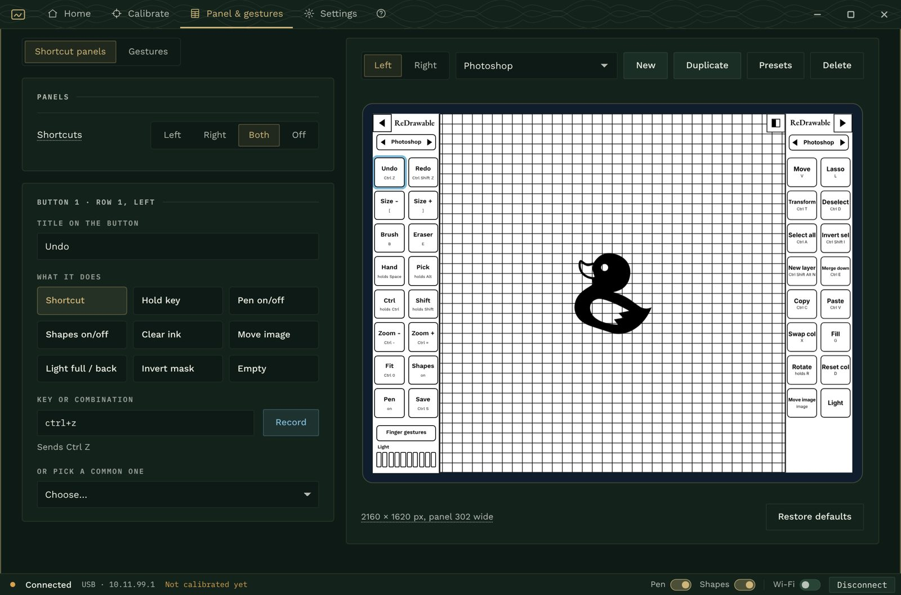
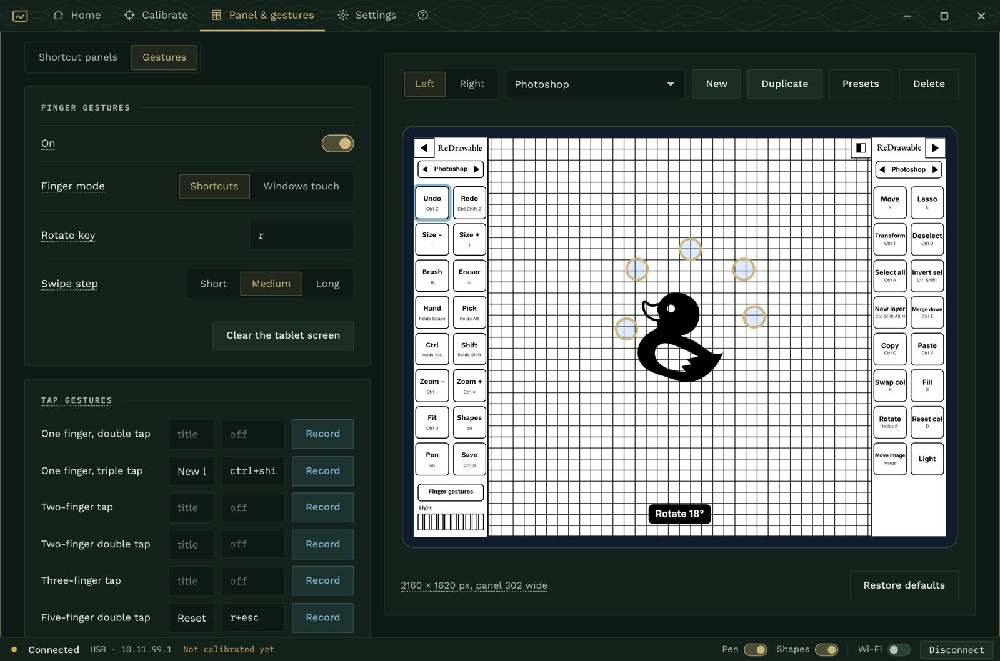
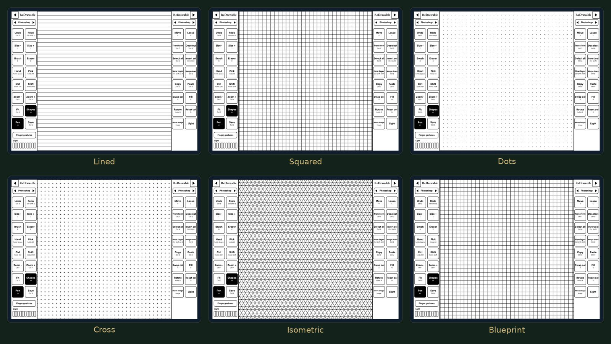
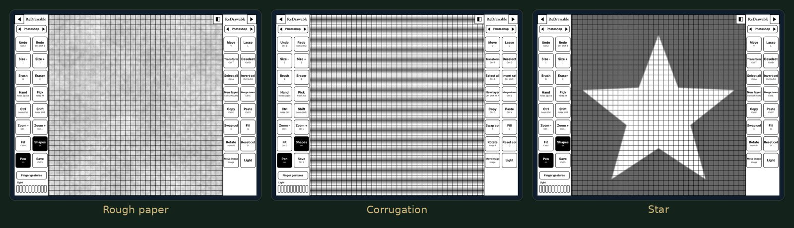
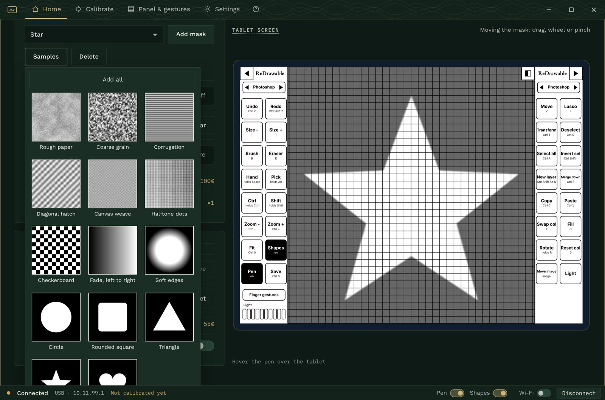
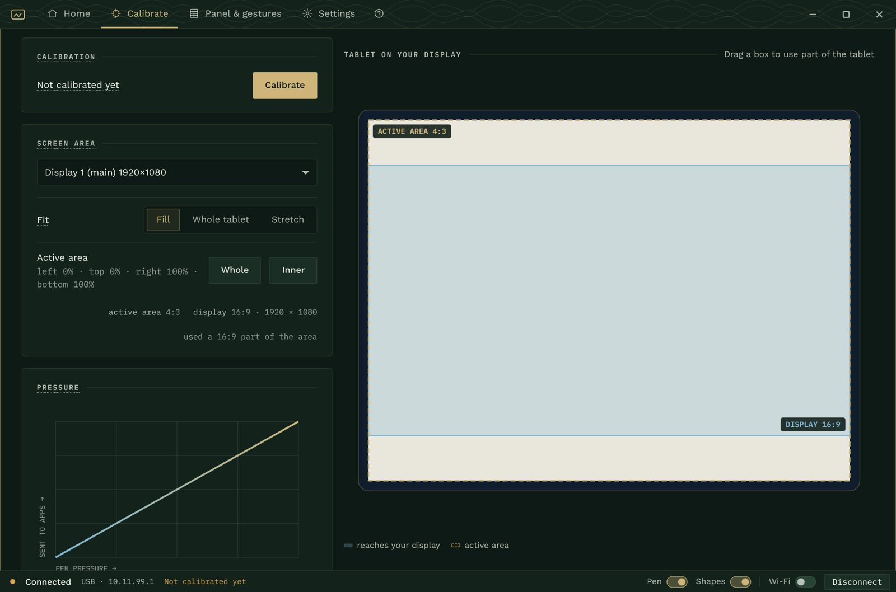

# ReDrawable
**Turn a reMarkable Paper Pro into a pressure-sensitive pen tablet for Windows.** The Paper Pro Move,
reMarkable 2 and 1 are supported in beta.

Plug the tablet in with its USB cable and draw in Photoshop, Krita, Clip Studio, Illustrator or any Windows Ink
app. You get pressure, tilt, hover and the eraser end. The tablet's own screen becomes your drawing surface:
paper patterns, a tracing image, pen masks and shortcut panels, with finger gestures for undo, redo, pan, zoom
and rotate.

**[Download ReDrawable](../../releases/latest)**: an installer, or a portable zip that runs from any folder.

> ReDrawable is an independent project. It is not made, endorsed or supported by reMarkable AS.
> It needs **developer mode** on the tablet, which is your own decision; read the safety notes below.

## What it does

### A real Windows pen

ReDrawable uses Windows' own pen input (Windows Ink), so apps see a pen, not a mouse, and no driver is needed.
4096 pressure levels, tilt, hover and the eraser end, at about 500 reports a second. Plug in and the pen and the
tablet screen start; unplug and the tablet goes back to your notebooks within seconds. Nothing is installed
permanently on the tablet.

### Shortcut panels with Photoshop presets

One panel on each side of the tablet, or just one, or none, with 16 buttons each. A button can tap a shortcut,
hold a key while your finger stays on it (Space to pan, Alt to pick), or switch the pen, shapes, front light or
mask. Keep named button sets for each app and switch with the arrows at the top of the panel. Photography,
Typography, Design and Art sets for Photoshop come with it, and *Presets* brings back any you delete. Each
panel folds away from its corner tab when you want the whole surface.

### Finger gestures

Three-finger swipe for undo and redo, two fingers to pan and pinch to zoom, a five-finger twist to rotate the
canvas, and tap gestures you can assign. The picture on *Panel & gestures* shows your fingers live, and a
small duck acts out each gesture as the tablet sends it. Fingers are ignored while the pen is near the screen,
and palm-sized contacts are always ignored, so a resting hand does nothing.

### Paper patterns

Lined, squared, dots, crosses, isometric or blueprint paper under your strokes, at the spacing you pick in
millimetres. Switch it from the app or from the tablet itself.

### Tracing images

Put a photo or sketch under your strokes and set how strongly it shows. Move and zoom it with your fingers on
the tablet, or by dragging it on the tablet picture in the app. The front light can go to full while you
trace and comes back to your level afterwards.

### Pen masks

A mask is a stencil in shades of grey: black ignores the pen, white leaves it alone, and grey either fades the
pressure or needs a firmer press. Make one from any image, or start from 14 sample masks: rough paper, grain,
corrugation, hatching, canvas weave, halftone dots, fades and shapes. Move and zoom it, invert it, and set its
contrast and strength; the tablet picture shows it at the strength it will have. Switch masks from a corner
tab on the tablet.

### Hold to snap

Draw a line, circle, ellipse, triangle, rectangle or polygon, hold the pen still, and it becomes a clean shape,
as in the tablet's own notebooks.

### Calibrate and pen feel

Calibrate with 9, 4 or 0 targets, pick a display, and drag out the part of the tablet you want to use. The
pressure curve, light-touch threshold, tilt and edge lift live on the same page.

### Wi-Fi

Plugged in once, the app can switch on reMarkable's own SSH over Wi-Fi and then find the tablet on your
network with the cable out (Settings). It only logs in to the tablet whose key it saw on the cable. Use it on
networks you trust; the cable stays the faster link.

*(The desktop screenshots show the app with sample data.)*

## Requirements

- A **reMarkable Paper Pro** with **developer mode** turned on. Tested on software 3.29.
- Or, in beta and not yet tested on real hardware, a **reMarkable Paper Pro Move** with developer mode turned
  on, software 3.29.
- Or, in beta and not yet tested on real hardware, a **reMarkable 2** or **reMarkable 1** on software 3.28 or
  newer. These need no developer mode. They have no front light, so the light controls do nothing there.
- **Windows 10 (1809 or newer) or Windows 11**, and the USB-C cable.
- The installer and portable version bring everything else with them. Running from source needs Python 3.10+.

## Install

Download from [Releases](../../releases):

- **`ReDrawable-Setup-x.y.z.exe`** installs for your user account only, with no admin rights. It upgrades an
  existing Paper Tablet install in place, and your settings move over by themselves.
- **`ReDrawable-Portable-x.y.z.zip`** needs no installation. Unzip it anywhere, even onto a USB stick, and run
  *ReDrawable*. Settings, calibration and the app's key stay in the `data` folder next to it.

The builds aren't code-signed yet, so Windows SmartScreen may warn the first time you run them
(*More info → Run anyway*).

**From source:** clone this repo and double-click `ReDrawable.bat`. It installs `paramiko` and `pywebview`
once, then starts the app.

## First run

The setup guide opens by itself and walks you through it:

1. **Back up your notebooks.** Developer mode resets the tablet.
2. **Turn on developer mode** on the tablet, then plug it into the PC.
3. **Pair.** Type the tablet's password once (it's shown on the tablet under *Settings → General → Help →
   About → Copyrights and licenses*). The app uses it once to install its own key on the tablet, and never stores it.
4. **Tell it how the tablet lies on your desk, then calibrate.**

After that, plugging in is all it takes.

## Using it

**In your drawing app.**
- Photoshop uses Windows Ink by default. Turn on *Pen Pressure* for brush size or opacity. If a
  `PSUserConfig.txt` containing `UseSystemStylus 0` exists in Photoshop's settings folder, remove it.
- Krita, Clip Studio, Illustrator and Affinity: choose their *Windows Ink* or *Windows Pointer* tablet mode.
- Apps that only speak **WinTab** see a pen without pressure.

**Shortcut panels.** On *Panel & gestures*, click a button to set its title and what it does, and drag one onto
another to swap them. To set keys, press *Record* and hit the keys, or type something like `ctrl+shift+s`.
Button types: *Shortcut* taps its keys; *Hold key* holds them while your finger stays on the button (a quick tap
locks it); *Pen on/off*, *Shapes on/off*, *Move image*, *Light full / back*, *Invert mask* and *Clear ink*
do what they say; *Empty* leaves a gap.

**Gestures** (switch them off on the same page):

| Gesture | Does |
|---|---|
| 3 fingers, swipe left / right | Undo / redo, one step per stretch of the swipe, live; dragging back takes steps back |
| 2 fingers, drag | Pan (holds Space and drags, like the hand tool) |
| 2 fingers, pinch | Zoom in / out (Ctrl+= / Ctrl+-) |
| 5 fingers, twist | Rotate the canvas (holds R and drags; Shift+Space for Krita / Clip Studio) |
| 1 finger, triple tap | New layer (Ctrl+Shift+Alt+N), changeable |
| 5 fingers, double tap | Reset the canvas rotation (holds R and presses Esc; Krita: 5), changeable |
| 5 fingers, swipe down | Clear the tablet ink and cleanly refresh the whole screen |
| 1-finger double tap, 2-finger tap and double tap, 3-finger tap | Off until you assign keys |

The presets follow Photoshop's default shortcuts. Krita and Clip Studio use most of the same keys; change any that differ.

**Hold to snap.** Draw a shape and keep the pen still for 0.6 s. The app lifts the pen, presses Ctrl+Z to
remove your stroke, and draws the clean shape with your stroke's own pressure. Because it relies on Ctrl+Z
removing exactly one stroke, it only works in the drawing programs listed under *Only in*.

## Safety: what it does to your tablet

- **Nothing permanent.** The pen helper and the tablet-screen app are copied to `/tmp` (cleared on every reboot)
  and run only while you use them.
- While the tablet screen is on, the notebook app is paused. It is **always restarted** when the screen is
  turned off, the cable is pulled, the PC app closes or crashes, or you press the power button. If the tablet
  ever stays blank, hold the power button to restart it.
- Your notebooks are never read or changed.
- Login uses an SSH key the app makes for itself. The tablet password is used once to install that key, and
  is never saved.
- Developer mode itself is reMarkable's feature, and turning it on resets the tablet. Read reMarkable's own
  guide first.

## Building

- **Run the tests:** `cd pc && python -m unittest test_shapes test_rmtablet test_panel`.
- **The tablet programs** are built with reMarkable's official SDK
  (`SDK=/path/to/sdk tablet/companion/build.sh`). Prebuilt binaries are in the repo.
- **The installer and portable zip** are built with the scripts in `installer/` (embedded Python + Inno Setup).
  `installer/make_sample_masks.py` regenerates the sample masks.
- **Portable mode** works with any copy: put an empty file named `portable` (or `portable.txt`) next to
  `ReDrawable.bat` or the exe, and everything is kept in `data\` beside it.

[docs/TECHNICAL.md](docs/TECHNICAL.md) covers how it works: measured hardware ranges, the tablet-screen app,
and the command-line tool.

## Licence

MIT, see [LICENSE](LICENSE). The bundled fonts (IBM Plex, EB Garamond, Libre Franklin, Work Sans) are under the SIL Open Font License
(`pc/web/fonts/`). The gesture duck is the "small duck" icon from SVG Repo. The tablet-screen app links against
the Qt libraries already on the tablet. "reMarkable" and "Paper Pro" are trademarks of reMarkable AS, used here
only to say which device this works with.
